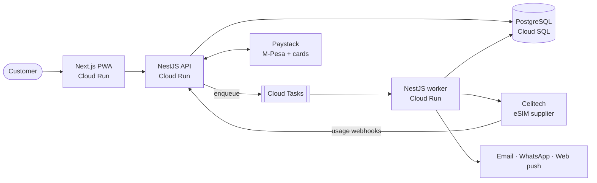
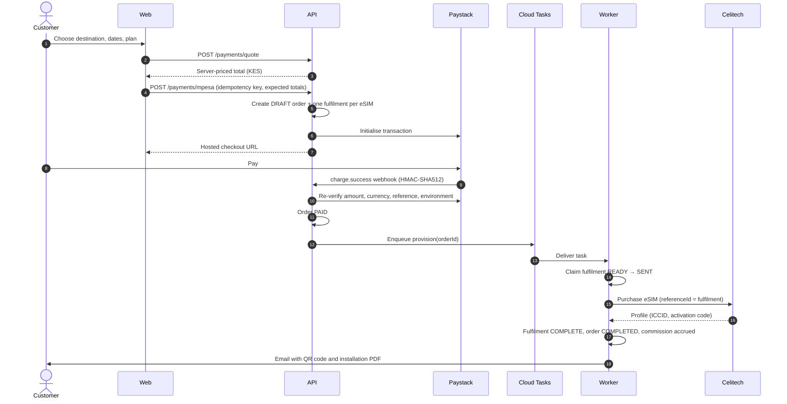

# GlobalSimify

[](https://github.com/casochiowi01-lang/GlobalSimify/actions/workflows/ci.yml)

A production eSIM storefront for international travellers. Customers pick a
destination and travel dates, pay with M-Pesa or card through Paystack, and
receive an installable eSIM (QR code and activation details) within seconds.
Travel agencies earn commission through a partner programme.

> **About this repository.** The public edition of the codebase behind a
> production eSIM storefront launched in September 2026. Supplier wholesale
> prices are replaced with synthetic sample data, internal operations runbooks
> are omitted, and cloud identifiers are placeholders.

## Why it is interesting

Money is taken before the eSIM is bought from the supplier, so the core
problem is never charging twice and never buying twice when networks,
webhooks and workers fail. Every design decision below serves that.

- **Idempotent checkout.** Each checkout key is bound to a SHA-256 hash of the
  selection. A replay returns the original order, a mismatched reuse is
  rejected, and concurrent requests resolve through the database's unique
  constraint rather than application locks.
- **Exactly-once supplier purchases.** Every eSIM is a fulfilment row that is
  claimed `READY → SENT` with a conditional update before the billable call.
  An attempt whose outcome is unknown is reconciled by supplier reference and
  never re-purchased automatically.
- **Crash-safe background work.** Paid orders run on Cloud Tasks (or BullMQ,
  or an in-process fallback for local development) and are re-enqueued by a
  recovery sweep, all through the same idempotent saga.
- **Refunds that cannot fire twice.** A refund is claimed by status before the
  provider call, refused while supplier outcomes are unresolved, sent to
  manual review on timeout, and booked once even when webhooks repeat.
- **Launch safety.** Checkout disables itself when worker heartbeats go stale,
  test money can never buy live eSIMs, the quoted KES amount must match the
  server's, and webhooks are verified with HMAC-SHA512 over the raw body.

## Architecture



### Purchase to provisioning



If the supplier call (step 15) times out, the fulfilment stays `SENT`. Recovery looks the purchase
up by its reference instead of buying again; anything still uncertain goes to
manual review with the customer told not to pay twice.

## Tech stack

| Layer          | Choices                                                               |
| -------------- | --------------------------------------------------------------------- |
| Web            | Next.js 16 (App Router), React 19, TypeScript, Tailwind CSS, Serwist   |
| API and worker | NestJS 11, TypeScript (strict), Prisma, PostgreSQL, Zod config         |
| Payments       | Paystack hosted checkout (M-Pesa mobile money and cards)               |
| Supplier       | Celitech eSIM API (mock and live adapters)                             |
| Infrastructure | Google Cloud Run, Cloud SQL, Cloud Tasks, Secret Manager, Cloud Build  |
| Quality        | Jest, Node test runner, ESLint, Prettier, GitHub Actions               |

## Features

- Destination search, plan recommendation by trip length, and server-side
  quotes with FX snapshots and configurable margin, buffer and processor fee
- Checkout by M-Pesa or card, promo codes, and multi-eSIM orders
- Email one-time-code login with rotating httpOnly refresh sessions, plus
  Google and Apple sign-in
- My eSIMs dashboard: QR codes, installation PDFs, live data usage with
  50/80/100% alerts, and top-ups that extend an existing eSIM
- Partner programme with referral links, commission accrual and payouts
- Admin console: orders with retry and refund, analytics, customers, admins,
  promotions, pricing and support tickets
- Installable, offline-capable PWA and an opt-in AI support assistant

## Repository layout

```
apps/
  api/        NestJS API and background worker (one image, two roles)
    src/modules/       Domain modules: orders, payments, pricing, partners, ...
    src/integrations/  Celitech, Paystack, email, SMS and WhatsApp adapters
    prisma/            Schema and migrations
    test/              Contract and order-lifecycle tests
  web/        Next.js PWA
docs/         Architecture and deployment notes
cloudbuild.*.yaml      Build, migrate and deploy pipelines for Cloud Run
```

## Running locally

Requires Node.js 22+. The API runs in **mock mode** by default: the supplier
and payment providers are simulated and no external accounts are needed.

```bash
# API: http://localhost:3000 (routes under /api/v1, Swagger at /docs)
cd apps/api
npm ci
cp .env.example .env
npm run start:dev

# Web: http://localhost:3001
cd apps/web
npm ci
npm run dev
```

For persistence, start PostgreSQL with `docker compose up -d`, set
`DATABASE_URL` in `apps/api/.env`, and run `npx prisma migrate dev`.

## Testing and quality gates

```bash
cd apps/api
npm run typecheck         # strict TypeScript
npm run lint
npm run format:check
npm test                  # Jest unit tests
npm run build && npm run test:contracts   # contract and lifecycle tests

cd apps/web
npm run typecheck && npm run lint && npm run format:check
npm test                  # Vitest unit tests
```

What the suites cover:

- **Order lifecycle**
  ([`apps/api/test/orders.test.cjs`](apps/api/test/orders.test.cjs)): the real
  checkout, provisioning and refund services against an in-memory database,
  covering checkout replays and races, exactly-once provisioning, crash
  recovery, reconciliation by reference, refund guards and the job queue.
- **Real database**: CI starts PostgreSQL, applies every migration to an empty
  database, fails if the migrations and `schema.prisma` have drifted, then runs
  concurrent provisioning, top-ups and recovery against it.
- **Contracts**: supplier and payment adapters, webhook signatures, pricing,
  launch gates, worker dispatch, eSIM delivery and assistant access control.
- **Web**: plan recommendation, trip-length rules, safe post-login redirects
  (including open-redirect attempts), device detection and referral cookies.

Every suite runs in CI on each push. The API suites also run inside its Docker
build, so a failing test blocks deployment.

## Deployment

Cloud Build builds the API and web images, runs Prisma migrations against
Cloud SQL as a one-off Cloud Run job, then deploys the API, the private worker
and the web app to Cloud Run. Secrets live in Secret Manager, with the payment
and AI keys pinned by version so a rotation cannot change a running revision.

## Further reading

- [docs/ARCHITECTURE.md](docs/ARCHITECTURE.md): components, order and
  fulfilment state machines, payments, ledger and launch safety
- [docs/DEPLOYMENT.md](docs/DEPLOYMENT.md): pipelines, release switches and
  rollback
- [docs/SECURITY.md](docs/SECURITY.md): authentication, payments, authorization,
  platform hardening and how each control is tested
- [docs/ASSISTANT.md](docs/ASSISTANT.md): the support assistant's security
  model and limits
