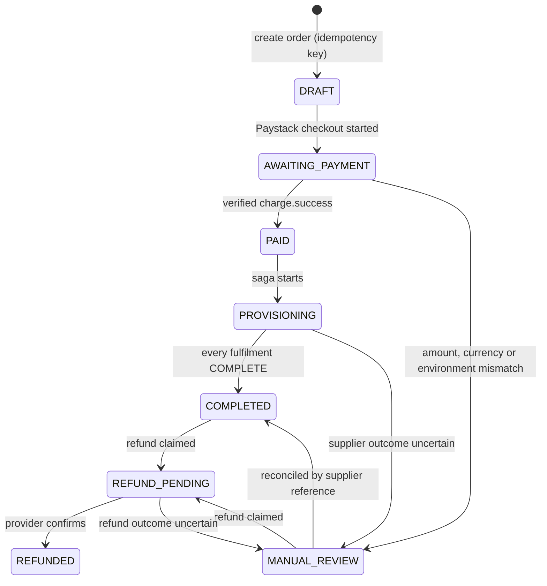
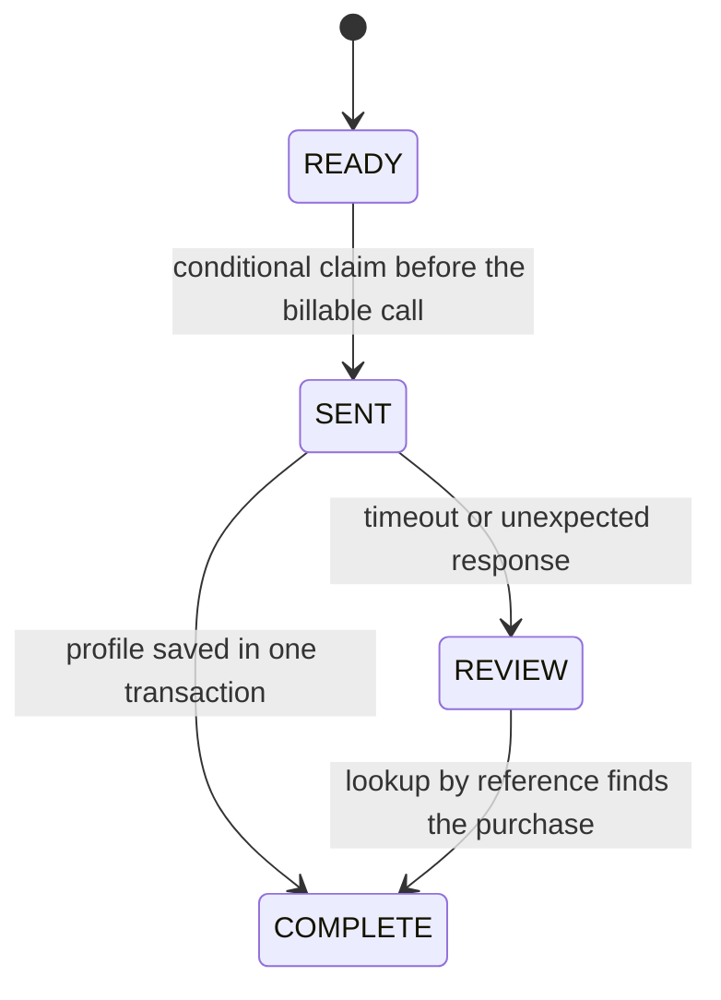

# Architecture

GlobalSimify takes a customer's money first and buys the eSIM from the
supplier second. Everything here exists so that a retry, a duplicated webhook
or a crashed worker can never charge twice, buy twice, or lose a paid order.

## Components

| Component  | Runtime              | Role                                                                  |
| ---------- | -------------------- | --------------------------------------------------------------------- |
| Web        | Next.js on Cloud Run | Storefront, checkout, account area, partner portal, admin console     |
| API        | NestJS on Cloud Run  | Public HTTP API, Paystack and Celitech webhooks, task dispatch        |
| Worker     | Same image, private  | Runs provisioning, email delivery and recovery tasks from Cloud Tasks |
| PostgreSQL | Cloud SQL            | Source of truth for orders, payments, fulfilments and the ledger      |

The API and worker are one image; `BACKGROUND_ROLE` selects the role. Public
routes can never run internal jobs, even with forged task headers.

### Background processing

`BACKGROUND_MODE` chooses how paid orders reach the provisioning saga:

- `cloud-tasks` (production): the API enqueues an OIDC-authenticated task for
  the private worker. The API only acknowledges a webhook after the task is
  durably enqueued.
- BullMQ (when `REDIS_URL` is set): one job per order (`jobId = orderId`), five
  attempts with exponential backoff.
- In-process (local development): bounded, de-duplicated dispatch.

In every mode a recovery sweep re-enqueues orders left in `PAID` or
`PROVISIONING`, and the saga itself is idempotent, so running it twice is safe.

## Order lifecycle

`PAYMENT_FAILED`, `CANCELLED`, `PROVISIONED` and `PROVISION_FAILED` remain in
the enum so historical rows stay readable; current code does not enter them.

### Fulfilments

Each eSIM in an order is a fulfilment row with its own supplier reference.

- The claim is an `UPDATE ... WHERE state = 'READY'`; only one worker wins.
- An attempt claimed less than two minutes ago belongs to the worker that
  claimed it and is left alone.
- `SENT` and `REVIEW` attempts are lookup-only. Recovery asks the supplier for
  the purchase by reference and never submits a second purchase.
- Saving the profile, marking the fulfilment complete and booking the supplier
  cost happen in one transaction; the order completes and partner commission
  accrues (upserted on `orderId`) in another.

## Payments

1. Checkout binds the idempotency key to a SHA-256 hash of the selection. A
   replay returns the original order; reusing the key for a different
   selection is rejected; concurrent requests resolve on the unique constraint.
2. The client must send the total and KES charge it was shown. If pricing or
   the FX rate moved, the order is refused before anything is saved.
3. Paystack webhooks are verified with HMAC-SHA512 over the raw request body,
   then the transaction is re-fetched and checked for amount, currency,
   reference and environment.
4. Marking the payment `COMPLETE`, moving the order to `PAID` and writing the
   revenue and fee ledger entries happen in one transaction, guarded so a
   repeated webhook changes nothing.

Refunds are claimed by moving the order to `REFUND_PENDING` before the
provider call, are refused while any fulfilment is unresolved, and are booked
in the ledger exactly once when the provider confirms.

## Ledger

Money movements are recorded as append-only `LedgerEntry` rows: customer
revenue and processor fees on payment, supplier cost per delivered eSIM, and
refunds. The admin console reconciles ledger totals against recorded
payments and refunds.

## Launch safety

- `LIVE_SALES_ENABLED` and live Paystack keys are both required for live
  purchases; test money can never buy a live eSIM and real money can never buy
  a mock one.
- `LIVE_SALES_ADMIN_ONLY` restricts live checkout to active administrators
  during acceptance testing, checked against the database on every request.
- Checkout disables itself if the worker's recovery, payment-reconciliation
  or email-delivery heartbeats are more than 15 minutes old, so nobody pays while delivery is down.
- A global rate limit (120 requests per minute per client) applies to all
  routes, with tighter limits on the AI assistant (6 per minute) and eSIM
  re-delivery (3 per minute).
- Configuration is validated with Zod at startup; production refuses to boot
  with test keys or inconsistent settings.
